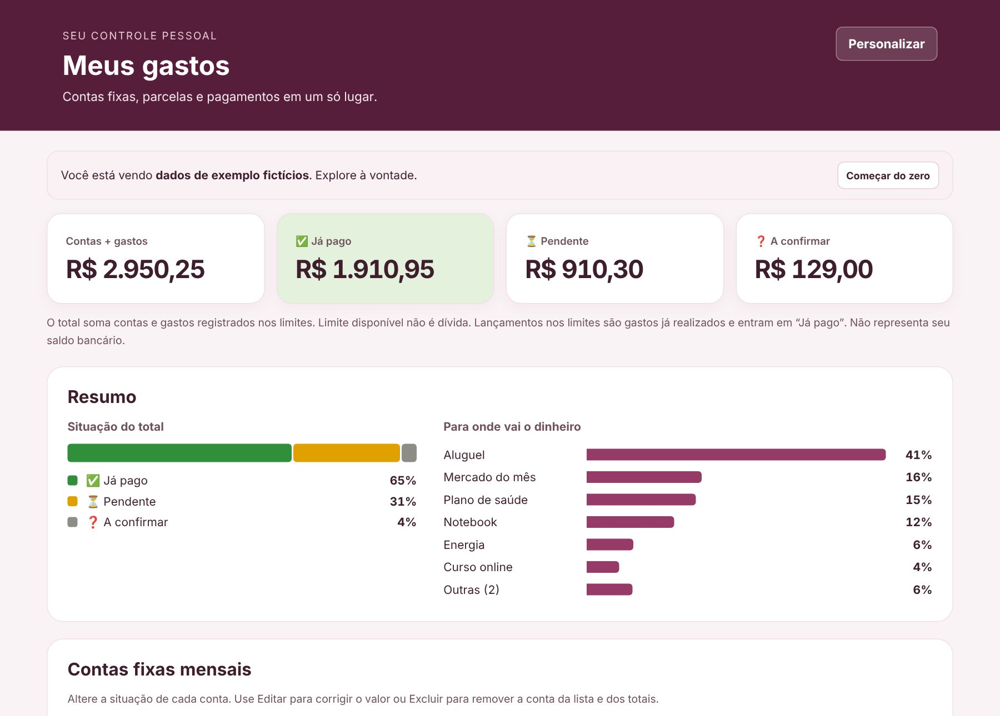
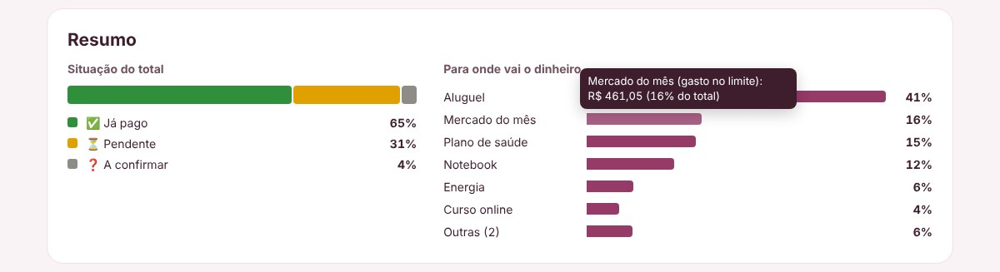
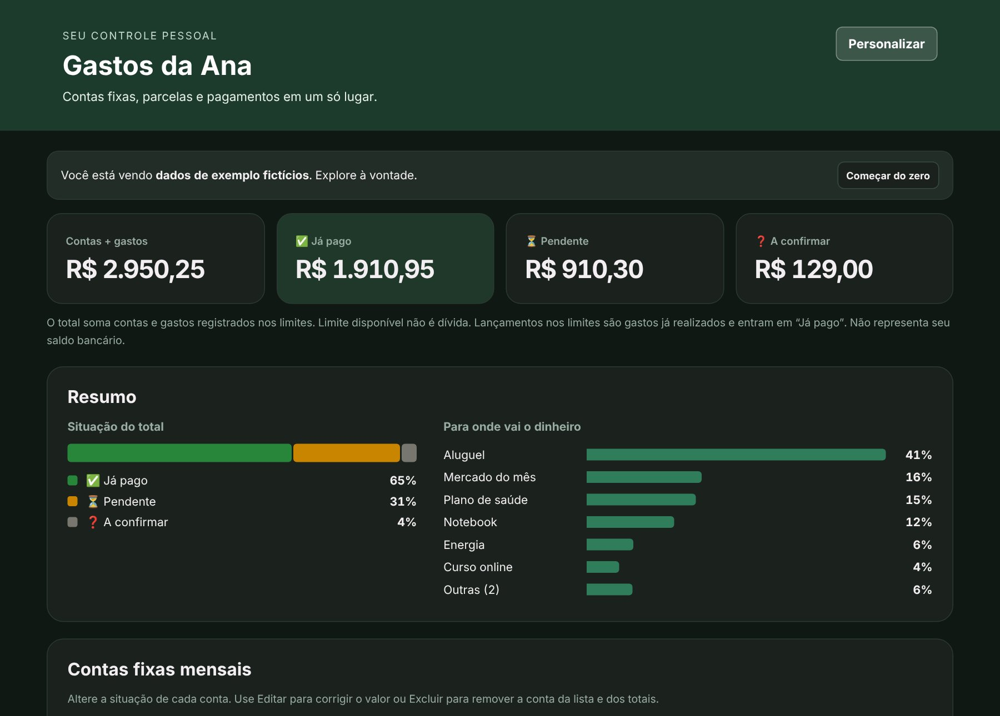
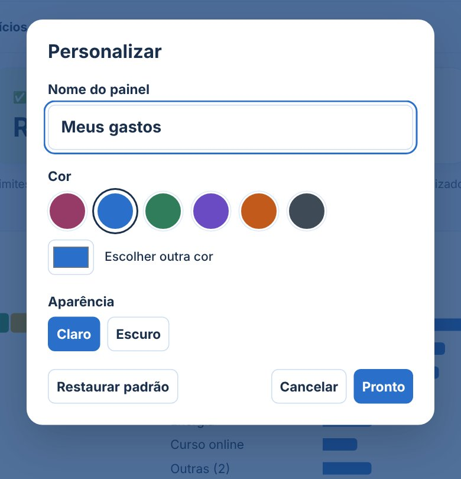
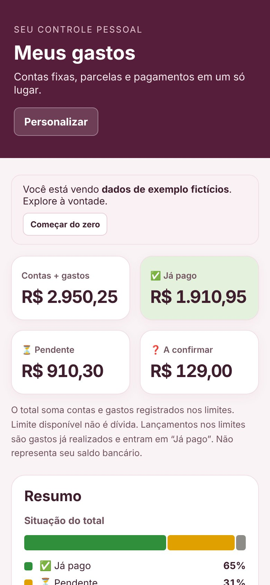

# Controle de Gastos

Sistema para organizar contas fixas, despesas, limites de gastos e compras parceladas, com **cor, aparência e nome personalizáveis** para cada pessoa.

**Use agora:** [controle-de-gastos-financeiro.pages.dev](https://controle-de-gastos-financeiro.pages.dev/)



## A história

Criei este sistema para controlar os meus próprios gastos. Minha namorada gostou e quis usar também, então fiz uma cópia para ela, vazia e com um tema rosa. Foi aí que ficou claro que cada pessoa quer o controle do seu jeito. Esta versão transforma isso em um recurso: qualquer pessoa escolhe a cor, o modo claro ou escuro e o nome do próprio painel.

## O que o sistema faz

- **Contas fixas mensais:** cadastrar contas recorrentes e seus valores.
- **Outros gastos e parcelas:** organizar despesas avulsas e compras parceladas.
- **Situação de cada conta:** pago, pendente ou a confirmar.
- **Limites de gastos:** definir um limite (ex.: mercado do mês), registrar cada gasto e ver quanto foi gasto e quanto resta. Mostra quando o limite é excedido.
- **Mensalidade com extras:** separar uma mensalidade dos gastos adicionais, como consultas e exames, cada um com sua situação.
- **Compras parceladas:** de 2 a 120 parcelas, com o total da compra e um botão para avançar à próxima parcela depois do pagamento.
- **Editar e excluir** contas e lançamentos.
- **Backup:** exportar e importar tudo em um arquivo JSON, incluindo a personalização.

## Resumo em gráficos



Logo abaixo dos totais, dois gráficos se atualizam a cada mudança:

- **Situação do total:** quanto do valor já foi pago, está pendente ou falta confirmar.
- **Para onde vai o dinheiro:** as contas que mais pesam no total, da maior para a menor. A partir da sétima, elas se juntam em "Outras".

Ao passar o mouse (ou focar pelo teclado), cada barra mostra o valor em reais e a porcentagem. As cores de situação vêm sempre com ícone e nome, para não depender só da cor.

## Totais

No topo aparecem o total de contas e gastos, o que já foi pago, o que está pendente e o que falta confirmar. O limite disponível não é contado como dívida, e os totais não representam saldo bancário.

## Personalizar

| Tema claro | Tema escuro |
|---|---|
|  |  |

No botão **Personalizar** a pessoa escolhe:

- **Cor:** seis cores prontas (rosa, azul, verde, roxo, laranja e grafite) ou qualquer outra cor.
- **Aparência:** clara ou escura.
- **Nome do painel:** por exemplo, "Gastos da Ana" no lugar de "Meus gastos".



Todo o tema é gerado a partir de uma única cor, com `color-mix()` no CSS. A cor do texto sobre os botões é escolhida pela luminância da cor, para continuar legível em tons claros e escuros. As cores de situação (pago, pendente, excedido) são fixas para não mudarem de significado.

## No celular



## Como os dados são guardados

Os registros ficam no `localStorage`, no navegador do aparelho onde foram cadastrados:

- Não há conta de usuário nem servidor. Nada é enviado para fora do navegador.
- Os dados não sincronizam entre celular e computador.
- Limpar os dados do navegador apaga os registros, por isso existe o backup.

Na primeira visita, o sistema mostra **dados de exemplo fictícios** para quem quiser explorar. O botão **Começar do zero** apaga o exemplo e deixa a lista vazia.

## Parte técnica

- **HTML, CSS e JavaScript puro**, sem dependências nem etapa de build.
- Valores guardados em **centavos inteiros**, para evitar erros de arredondamento.
- Leitura de valores no formato brasileiro: `1.250,00`, `89,90` ou `R$ 15`.
- Backup validado antes de importar (estrutura, tipos, parcelas e situações).

| Arquivo | Conteúdo |
|---|---|
| `index.html` | Estrutura da página e formulários |
| `style.css` | Layout, temas claro e escuro e adaptação para celular |
| `tema.js` | Personalização: cor, aparência e nome |
| `app.js` | Contas, limites, parcelas, cálculos, gráficos do resumo e backup |

## Como rodar

Abra o `index.html` no navegador, ou use um servidor local:

```bash
python -m http.server 8000
```

Depois acesse http://localhost:8000.

## Testes feitos

Testei no navegador, de forma automatizada, as seguintes funções: cadastro de cada tipo de conta, mudança de situação, limite com gasto e excesso, mensalidade com extras, parcelas e avanço de parcela, edição com valor no formato `1.250,00`, exclusão, exportação e importação de backup, persistência após recarregar, gráficos do resumo (soma dos percentuais e atualização) e personalização (nome, cor, modo, backup e cancelamento).

## Limites

É um controle manual: não há integração bancária, login nem sincronização entre aparelhos. Os totais mostram contas registradas, não o saldo da conta bancária.

---

Projeto de Wandley Vitor · [WV.LAB](https://github.com/wandleyvitor), desenvolvido com assistência de IA. Os dados das imagens são fictícios.
